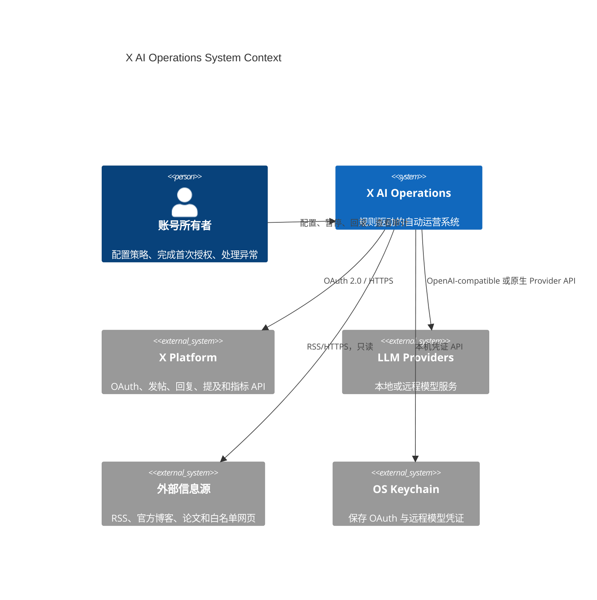
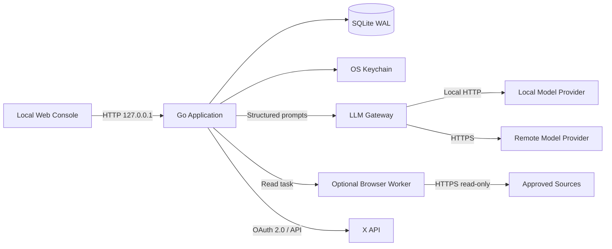
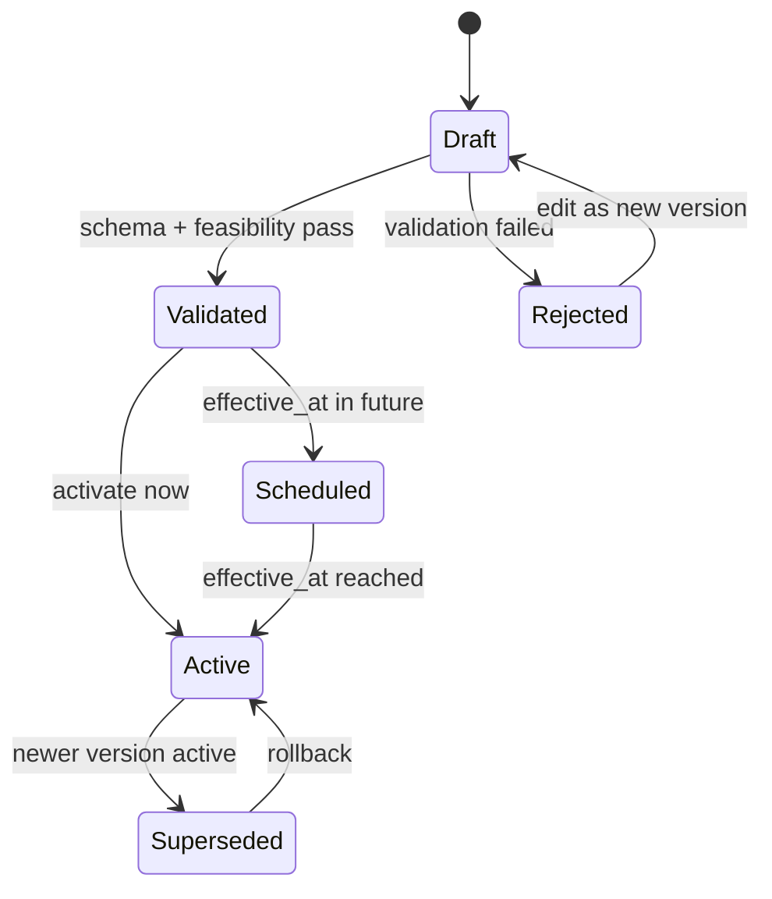
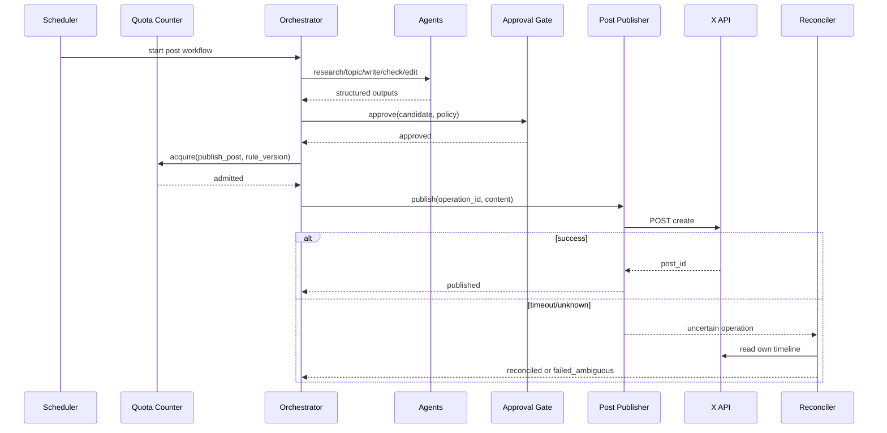
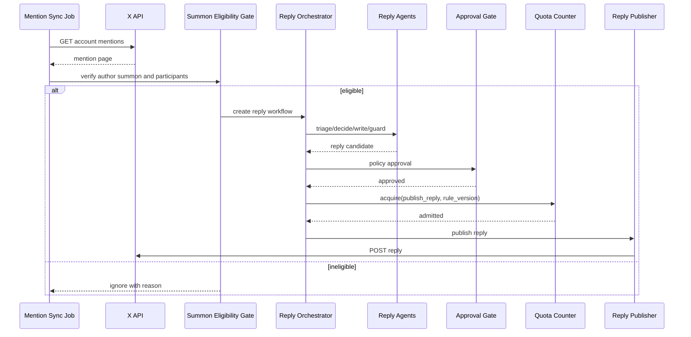
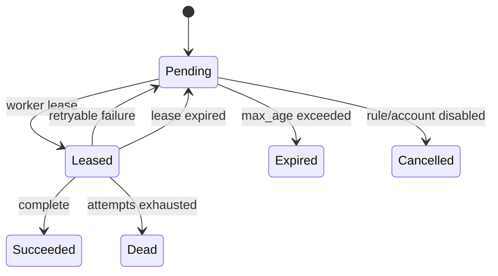
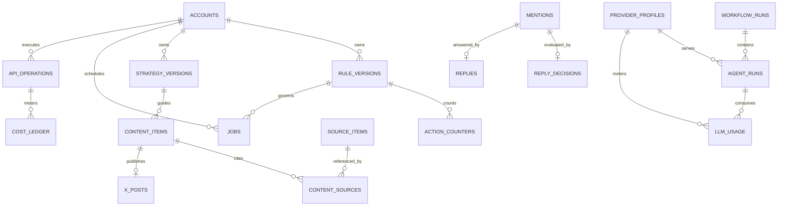

# X AI Operations 架构设计

- 状态：Implementation Baseline
- 日期：2026-10-16
- 关联文档：[产品与规则设计](design.md)

## 1. 文档目标

本文定义 X AI Operations 的可实施技术架构，覆盖：

- 系统边界和运行拓扑
- Go 模块与依赖方向
- 多 Agent 编排和结构化契约
- 版本化规则、配额、调度和队列
- 动态发布与召唤回复时序
- SQLite 数据模型与事务边界
- OAuth、X API、费用计量和结果对账
- 安全、可靠性、可观测性、部署和测试

本文不重复内容策略和运营指标定义。业务规则以
[docs/design.md](design.md) 为准；两份文档冲突时，先更新产品设计，再调整架构。

## 2. 架构目标与约束

### 2.1 目标

1. 所有支持操作均由版本化规则配置，例如动态 `10 条/天`。
2. 首次授权后可无人值守完成选题、写作、审核、排期、发布和分析。
3. Agent 只输出结构化决策，不直接访问凭证或 X API。
4. 动态与评论使用独立工作流、配额、冷却和执行器。
5. 任一外部写操作都可追溯到内容、来源、模型、策略和规则版本。
6. 进程崩溃、超时和重启不能造成可预见的重复发布。
7. 费用只计量和告警，不参与业务放行。
8. 首版保持单机简单部署，同时保留清晰的服务拆分边界。

### 2.2 硬约束

- X 内写操作只通过官方 API。
- 自助/按量层只回复原作者明确召唤账号的帖子。
- 平台政策、OAuth scope、API 限流优先于业务配置。
- 不实现自动点赞、转发、关注、私信和未召唤回复。
- 不保存 X 密码或浏览器 Cookie。
- 网络结果不确定的写操作不直接重试。
- Agent 无权创建、修改或激活规则版本。

### 2.3 首版范围

- 单机、单账号
- Go 模块化单体
- SQLite 持久化
- 可配置的本地或远程 LLM Provider
- X OAuth 2.0 与 X API
- 可选的外部信息源浏览器 Worker
- 本地管理控制台

多账号和分布式运行属于后续扩展，但表结构和领域接口必须包含 `account_id`。

## 3. 关键架构决策

| 决策 | 选择 | 原因 |
| --- | --- | --- |
| 服务形态 | 模块化单体 | 首版部署简单，仍可通过端口接口保持边界 |
| 业务数据库 | SQLite WAL | 单机可靠、零运维，适合当前吞吐量 |
| 任务队列 | SQLite Jobs + Lease | 与业务状态同事务提交，避免引入 Redis |
| 消息一致性 | Transactional Outbox | 业务变更与后续任务原子落库 |
| 模型接入 | LLM Gateway + Provider Adapter | 同时支持本地与远程模型，隔离供应商差异 |
| Agent 输出 | JSON Schema | 可验证、可审计、可重放 |
| X 写操作 | 确定性 Publisher | 禁止 LLM 直接执行账号操作 |
| 规则模型 | 不可变版本 + 定时生效 | 支持审计、回滚和任务复现 |
| 配额 | SQLite 原子计数器 | 精确执行每分钟/小时/天规则 |
| 凭证 | OS Keychain | 避免 token 明文进入数据库 |
| 费用 | Metering only | 按用户要求不设置应用预算上限 |

### 3.1 为什么首版不拆微服务

- 单账号的写入吞吐量很低。
- 规则、任务、配额和 Outbox 需要强事务一致性。
- 本地部署环境不适合维护数据库、队列和多个服务。
- 清晰的模块接口比进程数量更重要。

当出现多租户、远程部署或独立扩缩容需求时，再按 `Agent Runtime`、`Scheduler`、
`X Gateway` 和 `Analytics` 四个边界拆分。

## 4. 系统上下文



## 5. 容器与运行拓扑



### 5.1 运行单元

| 单元 | 形式 | 说明 |
| --- | --- | --- |
| `xops` | Go 单进程 | HTTP、调度、Worker、Agent 编排和 X Gateway |
| SQLite | 本地文件 | 业务数据、任务、Outbox、配额和审计 |
| LLM Gateway | Go 进程内模块 | 路由、能力协商、重试和计量 |
| Local Model Provider | 可选本地进程 | Ollama、vLLM、LocalAI 等 |
| Remote Model Provider | 外部服务 | OpenAI-compatible 或原生服务商 API |
| Browser Worker | 可选隔离进程 | 仅访问来源白名单，不持有 X token |
| OS Keychain | 系统服务 | 保存敏感 OAuth 与 Provider 凭证 |

管理控制台和 API 默认仅监听 `127.0.0.1`。远程部署时必须额外增加 TLS、身份认证和网络访问控制。

## 6. Go 模块架构

```text
cmd/server
internal/account
internal/source
internal/topic
internal/content
internal/engagement
internal/agent
internal/llm
internal/orchestrator
internal/workflow
internal/approval
internal/rules
internal/quota
internal/scheduler
internal/cooldown
internal/jobs
internal/outbox
internal/metering
internal/oauth
internal/xapi
internal/publisher
internal/replier
internal/analytics
internal/experiment
internal/policy
internal/audit
internal/httpapi
internal/store/sqlite
```

### 6.1 分层约束

```text
httpapi / scheduler / workers
              |
              v
       application services
              |
              v
        domain modules
              ^
              |
     adapter implementations
```

- Domain 不依赖 SQLite、HTTP、具体模型 Provider 或 X SDK。
- Application Service 负责编排事务和领域接口。
- Adapter 实现 Repository、LLM、X API、Clock 和 Credential Store。
- HTTP Handler 不直接访问数据库。
- Agent 不直接调用 Publisher、Rule Repository 或 Credential Store。

### 6.2 模块职责

| 模块 | 核心职责 | 不负责 |
| --- | --- | --- |
| `account` | 账号状态、暂停和时区 | OAuth token 内容 |
| `rules` | Schema、版本、激活、回滚、可行性校验 | 运行任务 |
| `quota` | 周期计数、原子占位和释放 | 平台限流 |
| `scheduler` | 计算槽位和创建 Job | 生成内容 |
| `jobs` | Lease、重试、超时和死信 | 领域决策 |
| `agent` | Prompt、Schema、模型调用和 Agent Run | X API |
| `llm` | Provider Registry、Adapter、路由、能力协商和 token 计量 | Agent 业务决策 |
| `orchestrator` | Agent DAG 和工作流状态 | 业务规则修改 |
| `content` | 动态候选、正文和来源关系 | 外部发布 |
| `engagement` | 提及、召唤证据、回复决策 | 未召唤搜索 |
| `approval` | 聚合风控结果和确定性检查 | LLM 推理 |
| `publisher` | 普通动态写入 | 回复 |
| `replier` | 合规 Reply 写入 | 普通动态 |
| `xapi` | API Client、限流和响应分类 | 内容决策 |
| `oauth` | PKCE、token 刷新和 Keychain 引用 | 发布业务 |
| `metering` | 资源和费用账本 | 操作放行 |
| `analytics` | 指标快照和归因 | 修改动作规则 |
| `audit` | 追加式审计事件 | 业务查询模型 |

### 6.3 核心端口接口

```go
type RuleRepository interface {
    Active(ctx context.Context, accountID string, at time.Time) (RuleVersion, error)
    SaveDraft(ctx context.Context, draft RuleDraft) (RuleVersion, error)
    Activate(ctx context.Context, versionID string, at time.Time) error
}

type JobRepository interface {
    Enqueue(ctx context.Context, job Job) error
    Lease(ctx context.Context, workerID string, now time.Time, limit int) ([]Job, error)
    Complete(ctx context.Context, jobID string) error
    Reschedule(ctx context.Context, jobID string, at time.Time, reason string) error
}

type LLMGateway interface {
    Generate(ctx context.Context, route ModelRoute, request AgentRequest) (AgentResponse, error)
}

type ProviderAdapter interface {
    Capabilities(ctx context.Context, profile ProviderProfile) (ModelCapabilities, error)
    Generate(ctx context.Context, profile ProviderProfile, request ProviderRequest) (ProviderResponse, error)
}

type XClient interface {
    CreatePost(ctx context.Context, request CreatePostRequest) (PostResult, error)
    CreateReply(ctx context.Context, request CreateReplyRequest) (PostResult, error)
    GetMentions(ctx context.Context, cursor string) (MentionPage, error)
    GetOwnPosts(ctx context.Context, query OwnPostsQuery) (PostPage, error)
    GetAccount(ctx context.Context) (AccountSnapshot, error)
}

type CredentialStore interface {
    Load(ctx context.Context, accountID string) (OAuthCredential, error)
    Save(ctx context.Context, accountID string, credential OAuthCredential) error
}
```

具体接口在实现时按调用方需要拆小，禁止形成包含所有 X 能力的全局 God Interface。

## 7. 规则引擎架构

### 7.1 规则生命周期



规则版本不可原地修改。回滚本质上是重新激活历史配置并产生新的激活审计事件。

### 7.2 校验阶段

1. YAML/JSON 解析。
2. JSON Schema 类型和必填字段校验。
3. Action Registry 校验，只允许系统支持的操作。
4. OAuth scope 与功能匹配校验。
5. 时间窗、时区和 Cron 语法校验。
6. `per_day`、时间窗和 `min_interval` 可行性校验。
7. 队列容量和任务时效校验。
8. 平台硬约束校验。
9. 生成规范化配置哈希。

### 7.3 Action Registry

```go
type ActionDefinition struct {
    Name           string
    RequiredScopes []string
    TriggerKinds   []TriggerKind
    Validator      ActionValidator
    Handler        JobHandler
}
```

首版注册：

| Action | Trigger | Handler |
| --- | --- | --- |
| `source_collect` | interval | Source Collector |
| `topic_generate` | quota | Topic Workflow |
| `publish_post` | quota | Post Workflow |
| `sync_mentions` | interval | Mention Collector |
| `publish_reply` | quota | Reply Workflow |
| `sync_account_metrics` | interval | Account Metrics Worker |
| `sync_post_metrics` | delayed | Post Metrics Worker |
| `update_strategy` | cron | Analytics Workflow |

新增操作必须通过代码注册和规则 Schema 升级，不能仅靠配置创建任意外部动作。

### 7.4 槽位计算

Quota 类型动作在每天开始或规则激活时生成执行槽位：

```text
available_windows = normalize(schedule.windows, timezone, day)
capacity = calculate_capacity(available_windows, min_interval)
assert quota.per_day <= capacity
slots = distribute_evenly(quota.per_day, available_windows, min_interval)
```

示例：

```text
规则：10 条/天
窗口：08:00-23:00
最小间隔：60 分钟
结果：生成 10 个确定性槽位，不在窗口外补发
```

若某个槽位没有通过审批的内容，则跳过该槽位。系统不在后续时间集中补发。

### 7.5 配额原子性

执行任务前，在单个 SQLite 事务中：

1. 读取生效规则版本。
2. 校验 Action 启用状态。
3. 校验任务绑定的规则版本是否仍允许执行。
4. 读取对应周期计数器。
5. 条件更新 `count = count + 1`。
6. 写入 Quota Decision 审计事件。

如果外部调用在发送前明确失败，可释放占位；一旦请求可能到达 X，不释放配额。

## 8. Agent 架构

### 8.1 LLM Gateway

所有 Agent 只依赖 `LLMGateway`，不依赖具体服务商 SDK：

```text
Agent
  -> LLM Gateway
      -> Provider Registry
      -> Capability Matcher
      -> Agent Router
      -> Request Normalizer
      -> Provider Adapter
          -> Local Provider
          -> Remote Provider
      -> Response Normalizer
      -> Token/Cost Meter
```

Gateway 负责：

- 加载 Provider Profile
- 检查模型能力
- 将 Agent 请求规范化
- 路由主模型和回退模型
- 执行超时、读取类重试和熔断
- 统一结构化输出
- 记录 token、延迟、供应商和模型
- 在远程发送前执行字段脱敏

Gateway 不负责内容决策、X 操作和动作规则。

### 8.2 Provider Adapter

优先支持 OpenAI-compatible API，但不假设所有模型都兼容同一协议：

| Adapter | 适用场景 |
| --- | --- |
| `openai_compatible` | Ollama `/v1`、vLLM、LocalAI 和兼容远程服务 |
| `ollama_native` | 需要 Ollama 原生能力时 |
| `anthropic` | Anthropic 原生 Messages API |
| `gemini` | Google Gemini 原生 API |

Provider Adapter 统一以下差异：

- 消息角色和 System Prompt
- JSON Schema / JSON Object 输出
- tool calling 表达
- 多模态输入
- token 统计
- finish reason
- 错误分类和限流头

新增服务商只需实现 `ProviderAdapter` 并注册协议名，Agent 和业务工作流不修改。

### 8.3 Provider Profile

Profile 是版本化配置，不保存密钥明文：

```yaml
llm:
  default_profile: "local"
  profiles:
    local:
      protocol: "openai_compatible"
      base_url: "http://127.0.0.1:11434/v1"
      api_key_ref: null
      model: "configured-local-model"
      capabilities: ["json_object"]
    remote:
      protocol: "openai_compatible"
      base_url: "https://provider.example.com/v1"
      api_key_ref: "keychain://xops/llm/remote"
      model: "configured-remote-model"
      capabilities: ["json_schema"]
```

`api_key_ref` 指向 OS Keychain。Profile 还可以配置连接池、超时、最大输出 token、温度和供应商费用目录。

### 8.4 能力协商

```go
type ModelCapabilities struct {
    JSONSchema       bool
    JSONObject       bool
    ToolCalling      bool
    Vision           bool
    MaxContextTokens int
    MaxOutputTokens  int
}
```

每个 Agent 声明最低能力，例如：

| Agent | 最低能力 |
| --- | --- |
| Writer | JSON Object、足够上下文 |
| Fact-check | JSON Object、较长上下文 |
| Policy | JSON Object、稳定枚举输出 |
| Vision Research | Vision、JSON Object |

若 Profile 不满足最低能力：

1. 尝试路由列表中的下一个 Profile。
2. 所有 Profile 都不满足时终止 Agent Run。
3. 不静默降低到无法验证的自由文本输出。

### 8.5 Agent 路由与回退

```text
agent-specific route
  -> default route
  -> select first healthy and capable profile
  -> call provider
  -> retry only safe transient failures
  -> fallback to next profile
```

示例：

```yaml
routing:
  default: ["local", "remote"]
  agents:
    fact_check: ["remote", "local"]
```

回退规则：

- 超时、`429` 和可重试 `5xx` 可以切换下一个 Profile。
- Schema 不兼容直接切换，不反复请求同一 Profile。
- 安全拒绝和内容策略拒绝不切换 Provider 绕过。
- 每次回退记录原 Provider、错误和最终 Provider。
- 同一次 Agent Run 的所有结果只采用最终成功响应。

### 8.6 逻辑 Agent

逻辑 Agent 通过 LLM Gateway 路由到本地或远程模型：

- Supervisor Agent
- Strategy Agent
- Research Agent
- Topic Agent
- Post Writer Agent
- Post Editor Agent
- Mention Triage Agent
- Reply Decision Agent
- Reply Writer Agent
- Conversation Guard Agent
- Fact-check Agent
- Policy Agent
- Similarity Agent
- Metrics Analyst Agent
- Experiment Agent

逻辑隔离依靠独立 Prompt、输入 Schema、输出 Schema、超时、token 上限和模型参数实现。

### 8.7 Agent Run 契约

每次调用保存：

```json
{
  "agent_type": "post_writer",
  "workflow_id": "wf_...",
  "input_schema_version": "1",
  "output_schema_version": "1",
  "prompt_version": "post-writer-v1",
  "provider_profile": "remote",
  "provider_protocol": "openai_compatible",
  "model": "configured-remote-model",
  "rule_version": "rule_...",
  "strategy_version": "strategy_...",
  "input_ref": "blob_...",
  "output_ref": "blob_...",
  "status": "succeeded",
  "started_at": "2026-10-16T10:00:00Z",
  "finished_at": "2026-10-16T10:00:04Z"
}
```

大文本存入 Blob 表或本地内容文件，运行表仅保存引用和哈希。

### 8.8 输出验证

1. JSON 解析。
2. Schema 校验。
3. 字段长度和枚举校验。
4. Prompt injection 标记检查。
5. 一次修复调用。
6. 仍失败则终止当前候选，不无限重试。

### 8.9 工具与数据权限

| Agent | 允许工具 | 禁止工具 |
| --- | --- | --- |
| Research | 白名单来源读取 | X API、凭证、规则写入 |
| Writer/Editor | 内容和来源读取 | 网络、X API |
| Reply Agents | 已保存线程上下文 | 任意 X 搜索、X 写入 |
| Policy/Similarity | 内容、历史内容 | 外部写入 |
| Analytics | 指标和实验读取 | 规则激活、X 写入 |

使用远程 Provider 时额外执行：

- 删除 token、账号凭证和内部路径
- 按配置脱敏个人信息
- 只发送 Agent 所需的最小字段
- 记录远程传输的数据分类和 Provider Profile
- `privacy.allow_remote=false` 时只选择本地 Profile

## 9. 工作流架构

### 9.1 动态发布时序



实际实现中，可在槽位前提前生成内容池；发布时仍需重新执行确定性审批和规则检查。

### 9.2 评论回复时序



资格检查在 LLM 调用之前和发布之前各执行一次，防止上下文变化或错误任务进入写入通道。

### 9.3 策略更新时序

Analytics Agent 只输出内容支柱权重和实验建议。它不能：

- 修改 `actions.*`
- 激活规则版本
- 增加 OAuth scope
- 解除账号暂停或熔断

动作数量只由配置文件或管理 API 修改。

## 10. 任务与 Outbox

### 10.1 Job 状态



### 10.2 Job 字段

| 字段 | 说明 |
| --- | --- |
| `id` | ULID |
| `account_id` | 账号隔离键 |
| `action` | Action Registry 名称 |
| `payload_ref` | 输入引用 |
| `rule_version` | 创建任务时的规则版本 |
| `run_at` | 最早执行时间 |
| `deadline_at` | 超过后过期 |
| `priority` | 同一时间的执行顺序 |
| `attempts` | 已尝试次数 |
| `max_attempts` | 规则快照中的上限 |
| `lease_owner` | Worker ID |
| `lease_until` | Lease 过期时间 |
| `state` | 当前状态 |

### 10.3 Lease 规则

- Worker 通过条件更新批量获取任务。
- Lease 到期后任务可被其他 Worker 重新获取。
- 执行 X 写入前必须转移到 API Operation 状态机，不能仅依赖 Job Lease。
- 长任务定期续租；模型调用超时后停止续租。
- 过期内容进入 `Expired`，不集中补发。

### 10.4 Transactional Outbox

在同一事务中保存业务状态和 Outbox Event：

```text
save approved content
increment workflow version
insert outbox(event=content.approved)
commit
```

Outbox Dispatcher 将事件转换为后续 Job，并使用 `event_id` 去重。

## 11. X API Gateway

### 11.1 请求管道

```text
domain request
  -> scope check
  -> platform policy check
  -> rate-limit admission
  -> token load/refresh
  -> api operation persisted
  -> HTTP request
  -> response classification
  -> cost metering
  -> state transition
```

### 11.2 Rate Limit Store

按 `account_id + endpoint` 保存：

- `limit`
- `remaining`
- `reset_at`
- `observed_at`

收到 `429` 后，将相关 Job 的 `run_at` 更新为 `reset_at`，不通过切换应用或账号规避。

### 11.3 写入幂等

X Create Post 不应被假设支持业务幂等键。系统采用：

- 调用前持久化 `api_operations`
- 正文规范化哈希
- 操作状态机
- 成功后保存 X Post ID
- 不确定结果读取自己的时间线进行核对
- 不确定写入默认不重试

### 11.4 Operation 状态

```text
prepared -> sending -> succeeded
                    \-> rejected
                    \-> uncertain -> reconciling -> succeeded
                                               \-> failed_ambiguous
```

### 11.5 OAuth

- Authorization Code Flow with PKCE
- 首次授权由用户完成
- `offline.access` 获取 refresh token
- 单账号只允许一个刷新协程持有 Refresh Lock
- access token 仅保存在内存
- refresh token 和 client secret 保存到 OS Keychain
- scope 变化需要重新授权，不静默扩权

## 12. 数据架构

### 12.1 数据关系



### 12.2 表所有权

| 表 | Owner 模块 |
| --- | --- |
| `accounts` | account |
| `credential_refs` | oauth/llm |
| `provider_profiles`, `model_catalogs`, `llm_usage` | llm |
| `rule_versions`, `action_counters` | rules/quota |
| `jobs`, `outbox_events` | jobs/outbox |
| `sources`, `source_items` | source |
| `topics` | topic |
| `content_items`, `content_sources` | content |
| `mentions`, `reply_decisions`, `replies` | engagement |
| `workflow_runs`, `agent_runs` | workflow/agent |
| `api_operations`, `x_posts` | xapi/publisher |
| `metric_snapshots`, `experiments` | analytics |
| `cost_ledger`, `pricing_catalogs` | metering |
| `audit_logs` | audit |

模块不得直接修改其他模块拥有的表，应通过 Application Service 或 Repository 接口。

### 12.3 SQLite 配置

```sql
PRAGMA journal_mode = WAL;
PRAGMA foreign_keys = ON;
PRAGMA synchronous = FULL;
PRAGMA busy_timeout = 5000;
```

- 使用单写连接池，读连接可并发。
- 所有时间以 UTC 存储，规则计算时使用账号时区。
- ID 使用 ULID，便于本地排序和未来分布式迁移。
- JSON 配置同时保存原文、规范化 JSON 和 SHA-256。

### 12.4 关键唯一约束

```text
rule_versions(account_id, version) UNIQUE
action_counters(account_id, action, period_start, period_kind) UNIQUE
jobs(dedupe_key) UNIQUE
outbox_events(event_id) UNIQUE
api_operations(operation_id) UNIQUE
x_posts(x_post_id) UNIQUE
mentions(account_id, x_post_id) UNIQUE
metric_snapshots(account_id, subject_type, subject_id, captured_at) UNIQUE
```

### 12.5 保留策略

- 规则、发布、回复、API Operation 和审计长期保留。
- 原始网页正文按来源许可和配置期限清理。
- Agent 输入输出默认保留 90 天，可配置缩短。
- 指标快照按日聚合后可清理高频原始数据。
- token 不进入数据库备份。

## 13. 事务与一致性

### 13.1 规则激活事务

```text
validate target version
mark current active as superseded
mark target version active
write audit event
write outbox(rule.activated)
commit
```

### 13.2 内容审批事务

```text
verify all guard results
transition content -> approved_auto
write approval decision
write outbox(content.approved)
commit
```

### 13.3 发布准备事务

```text
acquire quota
transition content -> rule_admitted
insert api_operation(prepared)
write audit event
commit
```

外部 HTTP 请求发生在事务提交之后。响应通过新的事务更新状态。

### 13.4 一致性模型

| 场景 | 模型 |
| --- | --- |
| 本地业务状态 | 强一致事务 |
| Job 与业务事件 | Outbox 最终一致 |
| X 写入结果 | Operation 状态机 + 对账 |
| 指标读取 | 最终一致 |
| 费用 | 估算后与 Usage 对账 |
| Agent 输出 | 不可变运行记录 |

## 14. HTTP 管理 API

首版仅提供本地 API：

| Method | Path | 用途 |
| --- | --- | --- |
| `GET` | `/api/v1/status` | 系统、账号和 Worker 状态 |
| `GET` | `/api/v1/providers` | 查询 Provider Profile 和健康状态 |
| `POST` | `/api/v1/providers/validate` | 验证连接与模型能力 |
| `POST` | `/api/v1/oauth/start` | 创建授权 URL |
| `GET` | `/api/v1/oauth/callback` | OAuth 回调 |
| `GET` | `/api/v1/rules` | 查询规则版本 |
| `POST` | `/api/v1/rules/validate` | 校验规则草稿 |
| `POST` | `/api/v1/rules` | 保存不可变版本 |
| `POST` | `/api/v1/rules/{id}/activate` | 立即或定时激活 |
| `POST` | `/api/v1/rules/{id}/rollback` | 回滚为历史配置 |
| `POST` | `/api/v1/accounts/{id}/pause` | 暂停所有动作 |
| `POST` | `/api/v1/accounts/{id}/resume` | 恢复允许动作 |
| `GET` | `/api/v1/jobs` | 查询任务和死信 |
| `GET` | `/api/v1/content` | 查询候选和发布记录 |
| `GET` | `/api/v1/interactions` | 查询提及和回复决策 |
| `GET` | `/api/v1/audit` | 查询审计 |
| `GET` | `/api/v1/metering` | 查询资源和费用 |

修改类接口要求 CSRF Token。远程模式还必须增加用户认证和 RBAC。

## 15. 安全架构

### 15.1 信任边界

| 区域 | 信任级别 |
| --- | --- |
| Domain/Rule Engine | 高 |
| X API Adapter | 高，持有短期 access token |
| Keychain Adapter | 高，访问 OAuth 与 Provider 凭证 |
| LLM Gateway | 高，访问 Provider Key 引用和脱敏数据 |
| Agent Runtime | 不可信输出 |
| Remote Model Provider | 外部信任边界 |
| 外部网页 | 不可信输入 |
| Browser Worker | 隔离、无 X 凭证 |
| Local UI | 默认本机可信，仍需 CSRF |

### 15.2 凭证

- refresh token、client secret 和远程模型 API Key 存入 Keychain。
- 数据库只保存 Keychain Item ID。
- access token 仅驻留内存，并在日志层统一脱敏。
- 错误对象不得包含 Authorization Header。
- 导出和备份不包含凭证。

### 15.3 Prompt Injection 防护

- Research Agent 只接收抽取后的正文和元数据。
- 网页中的指令性文本不得成为 System Prompt。
- Agent 不拥有规则、文件系统、凭证和 X 写工具。
- 引用来源与 Agent 指令分离存储。
- 风控 Agent 使用独立 Prompt，不继承 Research Agent 的自由文本指令。

### 15.4 远程模型数据边界

- Provider Profile 明确标记本地或远程。
- `privacy.allow_remote=false` 时 Router 不能选择远程 Profile。
- 发送远程 Provider 前执行字段级脱敏和最小化。
- 不向远程 Provider 发送 OAuth token、X 凭证、内部路径或 Keychain 引用。
- 每次远程调用记录数据分类、Provider、模型和输入哈希。
- Provider 的数据保留策略属于部署前必须确认的外部依赖配置。

### 15.5 权限最小化

默认 OAuth scope：

- `tweet.read`
- `tweet.write`
- `users.read`
- `offline.access`

启用媒体前才申请 `media.write`。系统不申请 follows、likes 或 DM 写权限。

## 16. 可靠性设计

### 16.1 故障矩阵

| 故障 | 处理 |
| --- | --- |
| 单个 LLM Provider 不可用 | Router 切换健康且能力匹配的下一个 Profile |
| 所有 LLM Provider 不可用 | Agent Job 退避，发布槽位可跳过 |
| Provider 返回非法结构 | Schema 修复一次，再切换 Profile |
| SQLite Busy | busy timeout 后短退避重试 |
| 进程崩溃 | Lease 到期后恢复，Operation 状态继续对账 |
| OAuth 过期 | Refresh Lock 下刷新一次 |
| `401` | 刷新后重试一次，再失败则暂停账号 |
| `403` | 暂停对应动作并告警 |
| `429` | 延迟到平台 reset 时间 |
| `5xx` 读取请求 | 按规则有限重试 |
| `5xx` 写请求 | 根据是否明确未提交决定，未知则对账 |
| 余额不足 | 暂停 X API 动作并告警 |
| 规则不可行 | 拒绝激活，不影响当前版本 |
| Job 积压 | 按 max_age 和 overflow 处理，不突发补发 |
| 浏览器 Worker 失败 | 来源任务失败，不影响发布器 |

### 16.2 熔断器

维度：

- `account`
- `action`
- `endpoint`
- `dependency`，例如 LLM Provider 或 Browser Worker

状态：

```text
closed -> open -> half_open -> closed
```

平台 `403`、连续授权失败和策略违规直接打开账号或 Action 熔断器。

### 16.3 启停语义

- Pause 不取消已成功的 X 操作。
- Pause 将待执行 Job 标记为不可租用。
- Resume 仅恢复未过期任务。
- 过期内容不会补发。
- 规则禁用 Action 后，对应待执行任务进入 Cancelled。

## 17. 可观测性

### 17.1 结构化日志

公共字段：

```text
timestamp
level
account_id
workflow_id
job_id
operation_id
action
rule_version
strategy_version
agent_type
error_class
```

日志禁止记录 token、Authorization、Cookie 和完整私信。

### 17.2 指标

| 指标 | 类型 |
| --- | --- |
| `jobs_pending{action}` | Gauge |
| `jobs_duration_seconds{action}` | Histogram |
| `rule_admission_total{action,result}` | Counter |
| `quota_used{action,period}` | Gauge |
| `agent_runs_total{agent,status}` | Counter |
| `agent_duration_seconds{agent}` | Histogram |
| `llm_requests_total{provider,model,status}` | Counter |
| `llm_tokens_total{provider,model,direction}` | Counter |
| `llm_fallback_total{from,to,reason}` | Counter |
| `llm_cost_estimated_usd{provider,model}` | Counter |
| `x_api_requests_total{endpoint,status}` | Counter |
| `x_api_rate_remaining{endpoint}` | Gauge |
| `publish_operations_total{kind,state}` | Counter |
| `cost_estimated_usd{endpoint}` | Counter |
| `circuit_breaker_state{name}` | Gauge |

### 17.3 告警

- 账号熔断器打开
- OAuth 连续刷新失败
- 任何 `failed_ambiguous`
- 配置激活失败
- Job 延迟超过规则窗口
- Dead Letter 非零
- X 余额不足
- 本地账本与 X Usage 差异超过阈值
- 数据库备份失败

## 18. 部署与运维

### 18.1 本地目录

```text
~/.x-ai-operations/
  config/
  data/xops.db
  data/content/
  backups/
  logs/
```

敏感凭证不写入该目录。

### 18.2 启动方式

macOS 首版使用 `launchd`：

- 按配置启动可选的本地 Model Provider
- 启动 `xops server`
- 崩溃后自动重启
- 标准输出进入滚动日志
- 优雅停机时间不少于 30 秒

### 18.3 启动检查

1. 数据目录权限。
2. SQLite migration。
3. Keychain 凭证引用。
4. 当前规则 Schema 与可行性。
5. Provider Profile、模型能力和至少一条 Agent 路由可用。
6. OAuth scope。
7. 未完成 Operation 对账。
8. 过期 Lease 回收。
9. Scheduler 启动。

只读管理页面可以在部分依赖失败时启动；外部写 Worker 必须在全部关键检查通过后启动。

### 18.4 备份

- 每日使用 SQLite Online Backup API。
- 保留最近 7 个日备份和 4 个周备份。
- 备份完成后执行 `PRAGMA integrity_check`。
- 恢复演练至少每月一次。
- 内容大文件与数据库使用同一备份代次标识。

## 19. 测试架构

### 19.1 单元测试

- 规则 Schema 和可行性计算
- 时区、跨日窗口和 DST
- Quota Counter 原子性
- 槽位分布
- 冷却和队列溢出
- URL/媒体/线程内容策略
- 召唤资格和线程参与者
- 状态机非法迁移
- 费用计算

### 19.2 集成测试

- SQLite migration、WAL 和事务回滚
- Job Lease 超时恢复
- Outbox 去重
- Keychain Fake
- OpenAI-compatible Fake Server
- Native Provider Adapter Fake
- X API Fake Server
- OAuth token 刷新并发锁
- `401/403/429/5xx` 分类

### 19.3 契约测试

- 每个 Agent 的输入/输出 JSON Schema
- X API 请求和响应 DTO
- Rule Config 向后兼容
- 数据库 Migration 前后读写

### 19.4 故障注入

- HTTP 请求发送后断开连接
- 写入响应丢失
- 进程在每个状态迁移点崩溃
- SQLite Busy 和磁盘空间不足
- Provider 超时、限流和非法 JSON
- 主 Provider 故障后的路由回退
- 规则在 Job 执行前切换
- 平台限流重置时间跨日

### 19.5 端到端模式

提供 `dry_run` X Adapter：

- 执行完整 Agent、规则、配额、调度和审批链路
- 不调用 X
- 生成可审查的拟发布记录
- 使用与生产相同的 Operation 状态机

上线前至少完成 7 天 dry-run，并验证示例 `10 条/天` 规则的执行率和无突发补发行为。

## 20. 非功能目标

| 目标 | 标准 |
| --- | --- |
| 规则遵循 | 所有动作可追溯到生效规则版本 |
| 重复发布 | 可预见场景为 0 |
| 凭证泄露 | 日志和数据库中为 0 |
| Job 恢复 | 进程恢复后一个 Lease 周期内继续 |
| 配置回滚 | 不重启进程即可生效 |
| 审计完整性 | 每次外部写入都有完整决策链 |
| 本地可用性 | 外部依赖恢复后自动续跑未过期任务 |

## 21. 演进路径

### 阶段一：模块化单体

- 单账号
- SQLite
- 进程内 Worker
- LLM Gateway 与可配置 Provider
- 动态自动发布

### 阶段二：评论与分析

- 提及同步
- 召唤回复
- 指标与实验
- 费用对账

### 阶段三：多账号

- 所有 Job、规则、配额和凭证按 `account_id` 隔离
- 每账号独立 Worker 并发和熔断器
- RBAC 和远程管理

### 阶段四：按边界拆分

当单机不再满足要求时：

- SQLite 迁移 PostgreSQL
- Jobs 迁移可靠队列
- Agent Runtime 独立部署
- X Gateway 独立部署
- Analytics 使用独立存储

领域对象、规则版本和 Operation 状态机保持不变。

## 22. 实施顺序

1. 建立 Go 工程、配置加载和 SQLite migration。
2. 实现 Rule Schema、版本、可行性校验和管理 API。
3. 实现 Jobs、Lease、Outbox、Quota Counter 和 Scheduler。
4. 实现 LLM Gateway、Provider Adapter、能力协商和路由。
5. 实现 Agent Runtime、Schema 验证和动态内容工作流。
6. 实现 OAuth、Keychain Adapter 和 X API Gateway。
7. 实现 Post Publisher、Operation 状态机和 Reconciler。
8. 实现 Mention/Reply 工作流和独立 Reply Publisher。
9. 实现 Metrics、Analytics、Cost Meter 和 Usage 对账。
10. 补齐 UI、审计、告警、备份和 dry-run。
11. 完成故障注入与 7 天无人值守验证。
